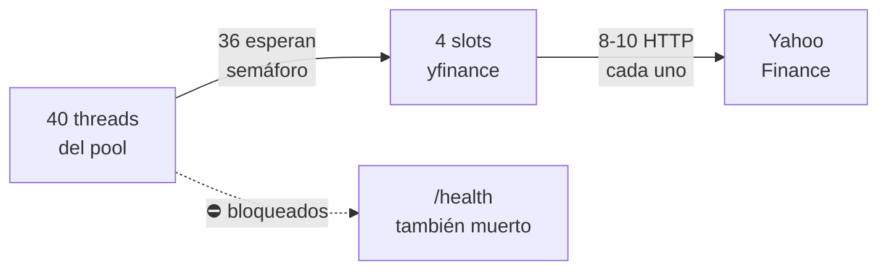

# 🔍 Auditoría EquityScope — Diagnóstico completo

He revisado los **26 archivos** del proyecto. El diagnóstico es claro: **la app se cuelga por una combinación de bugs en el backend y cómputo redundante en el frontend**. A continuación el desglose completo, ordenado por impacto.

---

## 🔴 Problemas CRÍTICOS (causan cuelgues)

### 1. Bug: `BoundedSemaphore.release()` sin `acquire()` → crash en cascada

> [!CAUTION]
> Este es probablemente el bug más destructivo del proyecto.

**Archivo:** [`service.py`](file:///c:/Users/fran_/Proyectos%20VScode/equityscope-main/backend/service.py#L113-L129)

```python
def fetch_company(symbol, ticker_factory=None):
    factory = ticker_factory or _default_ticker_factory
    if not _upstream_slots.acquire(timeout=15):      # ← Si timeout → False
        raise DataError(503, "El servicio está ocupado...")
    try:
        return _fetch(symbol, factory)
    except DataError:
        raise
    except Exception as error:
        ...
    finally:
        _upstream_slots.release()  # ← ¡SIEMPRE se ejecuta, incluso si acquire falló!
```

Cuando `acquire(timeout=15)` devuelve `False`, se lanza `DataError(503)`. Pero el `finally` ejecuta `release()` **sin haber adquirido**. En un `BoundedSemaphore`, esto lanza `ValueError: Semaphore released too many times`, que se convierte en un **500 interno** en lugar del 503 esperado. Peor aún: **corrompe el semáforo**, permitiendo más de 4 slots simultáneos, lo que amplifica la sobrecarga.

**Fix:**
```python
def fetch_company(symbol, ticker_factory=None):
    factory = ticker_factory or _default_ticker_factory
    if not _upstream_slots.acquire(timeout=15):
        raise DataError(503, "El servicio está ocupado...")
    try:                           # ← try/finally SOLO tras acquire exitoso
        return _fetch(symbol, factory)
    except DataError:
        raise
    except Exception as error:
        ...
        raise DataError(502, ...) from error
    finally:
        _upstream_slots.release()  # ← Ahora sí, siempre con acquire previo
```

---

### 2. Sin timeout en las llamadas HTTP a Yahoo Finance → hang infinito

**Archivo:** [`service.py`](file:///c:/Users/fran_/Proyectos%20VScode/equityscope-main/backend/service.py#L132-L180)

`_fetch()` hace **8-10 llamadas HTTP bloqueantes** a Yahoo Finance (`.financials`, `.balance_sheet`, `.cashflow`, las trimestrales, `.get_info()`, `.history()`). yfinance usa `requests` internamente con `timeout=None` (infinito). Si Yahoo responde lento:

1. Un request ocupa un slot del semáforo indefinidamente
2. Con 4 requests lentos, el semáforo se bloquea completamente
3. **Los 40 threads del pool de FastAPI se agotan esperando el semáforo**
4. Incluso `/health` deja de responder → Render reinicia el servicio

---

### 3. Thread pool starvation: endpoint sync + yfinance bloqueante

**Archivos:** [`main.py:53`](file:///c:/Users/fran_/Proyectos%20VScode/equityscope-main/backend/main.py#L52-L53), [`service.py:113-180`](file:///c:/Users/fran_/Proyectos%20VScode/equityscope-main/backend/service.py#L113-L180)

El endpoint `analyze()` es `def` (síncrono). FastAPI lo ejecuta en un thread pool de ~40 threads. Pero el semáforo solo permite 4 requests simultáneos a Yahoo. Con carga:



**Resultado:** Bajo carga moderada (>4 usuarios), la app se congela por completo.

---

### 4. Cache mantiene lock durante todo el fetch (10-30 segundos)

**Archivo:** [`cache.py`](file:///c:/Users/fran_/Proyectos%20VScode/equityscope-main/backend/cache.py#L47-L58)

```python
def get_or_create(self, key, factory):
    cached = self.get(key)
    if cached is not None:
        return cached
    with self._key_locks[hash(key) % 16]:  # ← Lock adquirido
        cached = self.get(key)
        if cached is not None:
            return cached
        value = factory()   # ← 10-30 segundos de HTTP bloqueante bajo lock
        self.set(key, value)
        return value
```

Solo hay 16 stripes de lock. Dos tickers que colisionen en hash serializan, aunque sean independientes. El lock se mantiene **todo el tiempo** que duran las llamadas a Yahoo.

---

## 🟠 Problemas de RENDIMIENTO ALTO

### 5. Frontend: 4× `calculateHistory` por cada pulsación de tecla

**Archivo:** [`App.tsx`](file:///c:/Users/fran_/Proyectos%20VScode/equityscope-main/src/App.tsx#L193-L206)

Cada vez que el usuario toca un input de supuestos:

| # | Dónde | Qué calcula |
|---|-------|-------------|
| 1 | `valuation` memo → [`calculateValuation` L124](file:///c:/Users/fran_/Proyectos%20VScode/equityscope-main/src/valuation.ts#L124) | `calculateHistory(data, taxRate)` |
| 2 | `valuation` memo → [`calculateValuation` L125-128](file:///c:/Users/fran_/Proyectos%20VScode/equityscope-main/src/valuation.ts#L125-L128) | `calculateHistory({...data, periods + ltm}, taxRate)` |
| 3 | `historical` memo → [App.tsx L197-199](file:///c:/Users/fran_/Proyectos%20VScode/equityscope-main/src/App.tsx#L197-L199) | `calculateHistory(data, taxRate)` — **duplicado de #1** |
| 4 | `tablePeriods` memo → [App.tsx L201-205](file:///c:/Users/fran_/Proyectos%20VScode/equityscope-main/src/App.tsx#L201-L205) | `calculateHistory({...data, periods + ltm}, taxRate)` — **duplicado de #2** |

**Son 4 llamadas a `calculateHistory` por keystroke.** Con empresas con muchos períodos, esto genera lag perceptible.

**Fix:** Derivar `historical` y `tablePeriods` de `valuation` en vez de recalcular:
```tsx
const historical = useMemo(() => valuation?.history ?? [], [valuation])
const tablePeriods = useMemo(
  () => valuation ? [...valuation.history, calculateHistory(
    { ...company!, periods: [company!.ltm] }, assumptions!.taxRate
  )[0]] : [],
  [valuation, company, assumptions],
)
```

O aún mejor: que `calculateValuation` exporte `allPeriods` directamente.

---

### 6. `redFlags` y `ChartsPanel` data no memoizados

**Archivos:** [`App.tsx:240`](file:///c:/Users/fran_/Proyectos%20VScode/equityscope-main/src/App.tsx#L240), [`ChartsPanel.tsx:36-54`](file:///c:/Users/fran_/Proyectos%20VScode/equityscope-main/src/ChartsPanel.tsx#L36-L54)

- `redFlags` se recalcula en **cada render**, sin `useMemo`
- `trendData` y `targetData` en `ChartsPanel` se reconstruyen en cada render, forzando a Recharts a reprocesar todo innecesariamente

---

## 🟡 Problemas MEDIOS

### 7. Llamada FX adicional sin timeout dentro de la ruta crítica

**Archivo:** [`service.py:83-91`](file:///c:/Users/fran_/Proyectos%20VScode/equityscope-main/backend/service.py#L83-L91), llamada desde [L161](file:///c:/Users/fran_/Proyectos%20VScode/equityscope-main/backend/service.py#L161)

Cuando la moneda de cotización difiere de la financiera, `_fx_rate()` crea un **nuevo** `yf.Ticker` y llama a `.history()` — otra llamada HTTP bloqueante, sin caché y sin timeout, mientras mantiene el lock del caché y el slot del semáforo.

### 8. Memory leak en el rate limiter bajo flood de IPs

**Archivo:** [`ratelimit.py:21,28-31`](file:///c:/Users/fran_/Proyectos%20VScode/equityscope-main/backend/ratelimit.py#L21-L31)

`_hits` crece hasta 10.000 entradas antes de limpiar. En Render free tier (512MB RAM), un DDoS con IPs variadas podría causar problemas de memoria.

### 9. Projected `investedCapital` y `interestExpense` congelados en LTM

**Archivo:** [`valuation.ts:146-168`](file:///c:/Users/fran_/Proyectos%20VScode/equityscope-main/src/valuation.ts#L146-L168)

En los 5 años proyectados:
- `interestExpense` e `interestIncome` usan valores LTM fijos — no evolucionan con la deuda
- `investedCapital` usa el LTM para todos los años — inflando ROIC artificialmente

Esto no causa cuelgues pero **sesga la valoración** (PER demasiado bajo, ROIC demasiado alto).

---

## 🟢 Problemas MENORES

| # | Problema | Archivo |
|---|----------|---------|
| 10 | `safeDivide` devuelve 0 para 0/0 en vez de `null` | [`valuation.ts:16-17`](file:///c:/Users/fran_/Proyectos%20VScode/equityscope-main/src/valuation.ts#L16-L17) |
| 11 | `.env.example` incompleto (faltan vars del backend) | [`.env.example`](file:///c:/Users/fran_/Proyectos%20VScode/equityscope-main/.env.example) |
| 12 | `requirements.txt` no fija `pandas` ni `requests` | [`requirements.txt`](file:///c:/Users/fran_/Proyectos%20VScode/equityscope-main/backend/requirements.txt) |
| 13 | Sin logging estructurado ni request IDs | Backend en general |
| 14 | No favicon → 404 en consola | [`index.html`](file:///c:/Users/fran_/Proyectos%20VScode/equityscope-main/index.html) |

---

## ✅ Cosas bien hechas

- **AbortController** en `App.tsx` para cancelar requests stale — correcto
- **Lazy loading** de `ChartsPanel` con `Suspense`
- **Validación de input** con regex en `api.ts`
- **Tests** bien estructurados y con imports correctos
- **CI/CD** bien configurado
- **CSS responsive** con breakpoints móviles

---

## 📋 Plan de acción recomendado

> [!IMPORTANT]
> Los fixes 1 y 2 son **imprescindibles** — sin ellos la app se colgará inevitablemente en producción.

### Prioridad inmediata
1. ✏️ **Fix del BoundedSemaphore** — mover `try/finally` tras el acquire exitoso
2. ✏️ **Añadir timeouts a yfinance** — envolver calls en `concurrent.futures.ThreadPoolExecutor` con timeout de 20s
3. ✏️ **Eliminar `calculateHistory` redundantes** — derivar de `valuation` object

### Prioridad alta
4. ✏️ Refactorizar cache para no mantener lock durante I/O
5. ✏️ Memoizar `redFlags` y chart data
6. ✏️ Hacer `/health` async (`async def health()`)

### Cuando sea posible
7. Evolucionar `interestExpense` e `investedCapital` en proyecciones
8. Limitar tamaño del rate limiter con LRU o TTL por entrada
9. Completar `.env.example`
